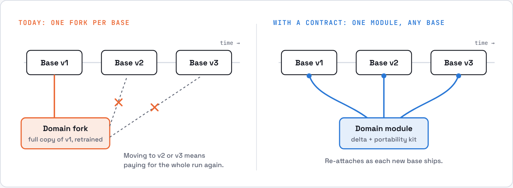
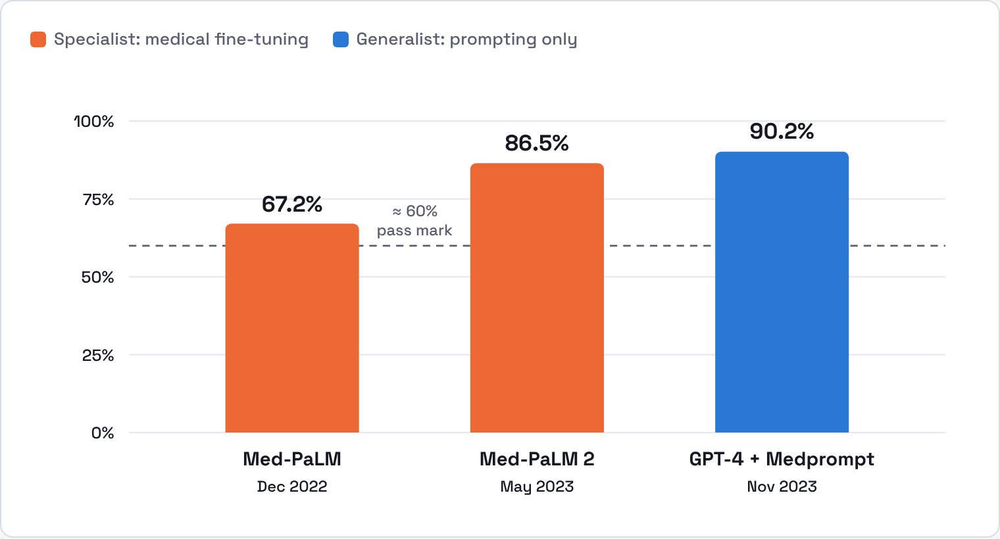
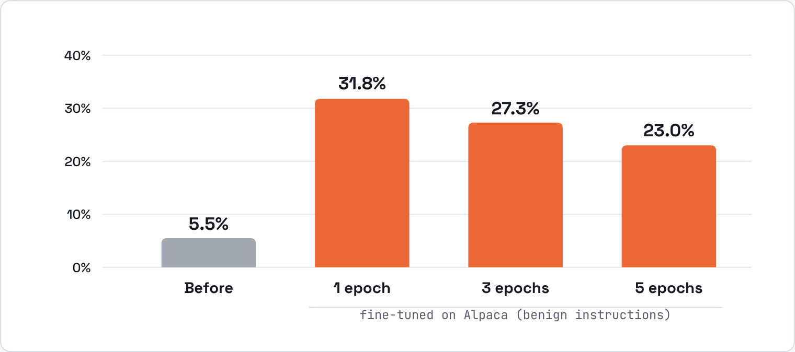
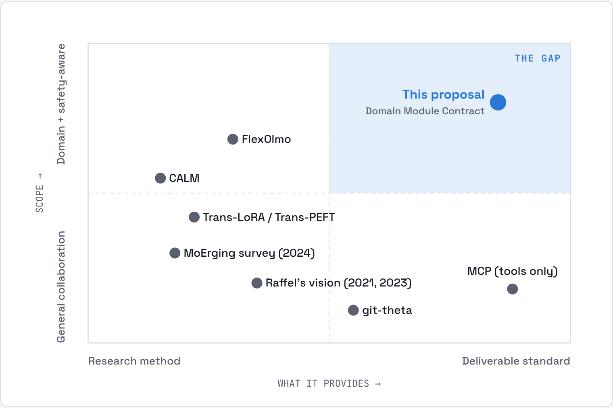
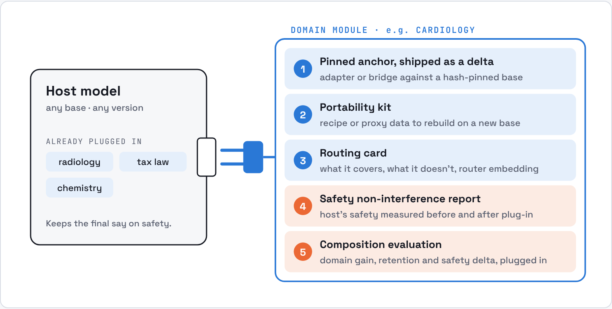
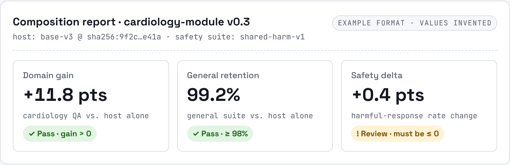
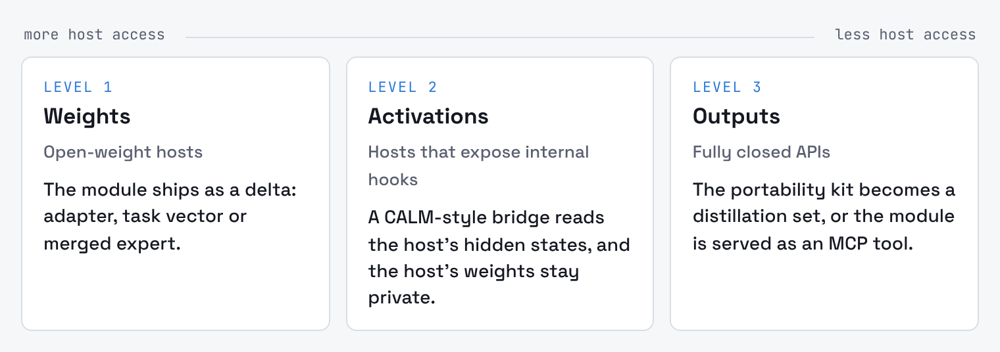

Every few months a stronger general AI model arrives. Specialist models for medicine, finance or law are usually built by copying one of these general models and training the copy on expert data. That copy is called a **fork**. A fork stays tied to the model it was copied from, so its expertise ages along with that model.

This post proposes an upgrade path: **ship the expertise as a module that plugs into any future model.** A module is a small add-on that holds only the domain knowledge. When a new base model arrives, the module moves over to it.

<figure class="post-figure"><figcaption class="caption"><b>Figure 1.</b> Today a domain model is a full copy of one base model, and it stays tied to that base. Under a shared contract, the domain knowledge ships as a separate module that attaches to each new base.</figcaption></figure>

In 2021 Colin Raffel [argued](https://colinraffel.com/blog/a-call-to-build-models-like-we-build-open-source-software.html) that we should build models the way we build open source software, with many contributors, steady improvement, merges and versions [1]. Five years later the research tools for this exist. The next step is a shared agreement on what a specialist team should release.

I propose one below, called the **Domain Module Contract**. It adds two requirements to earlier ideas: keep the host model's safety behavior intact, and measure what a module adds once it is plugged in.

## General models keep catching up

A team builds the best model in its field. Months later a general model matches it using public knowledge alone. Medicine is the clearest example.

<figure class="post-figure"><figcaption class="caption"><b>Figure 2.</b> Accuracy on MedQA, a set of medical licensing exam questions. Six months after Med-PaLM 2, GPT-4 with general purpose prompting and zero medical training scored higher, cutting the error rate by 27% [2, 3].</figcaption></figure>

Finance followed the same path. BloombergGPT, a 50 billion parameter model trained on a large private financial dataset, led similarly sized general models in early 2023. Soon after, an independent study found GPT-4 _"consistently competitive with or superior to"_ specialist finance models on public benchmarks, using only a few examples in the prompt [4].

Open projects share the pattern. MEDITRON-70B was built on Llama 2 with a knowledge cutoff of August 2023 [5]. Its carefully curated medical knowledge now sits on a base model several generations old.

The domain knowledge in these projects is real and valuable. The lesson is about **where it is stored**. Knowledge kept inside a copy of one base model ages with that base. Knowledge kept in a module can move forward.

## What a fork costs

- **A short shelf life.** A fork is tied to one version of a base model. New base models now ship every few months.
- **Lost general skills.** Retraining a whole model teaches the domain and can weaken everything else. Lighter methods such as LoRA, which train a small add-on, keep more of the base model's general ability [6].
- **Weaker safety.** Ordinary, harmless training data can loosen a model's safety training. Each fork is a new model that needs its own safety audit [7].

The third cost is the easiest to miss and the most important. Qi et al. showed that 10 harmful examples, costing under $0.20, could remove the guardrails of GPT-3.5 Turbo. The result that matters most for well meaning builders involves harmless data:

<figure class="post-figure"><figcaption class="caption"><b>Figure 3.</b> Share of GPT-3.5 Turbo responses rated highly harmful, before and after training on a harmless instruction dataset (Alpaca). The training data was ordinary, yet harmful outputs rose almost sixfold [7].</figcaption></figure>

## The building blocks already exist

A standard can be built from techniques that work today:

- **Adding skills like numbers.** A "task vector" is the difference between a trained model and its base. Task vectors can be added together to give one model several skills with zero retraining [8].
- **A thin bridge between two models.** Google's CALM keeps a general model and a specialist model unchanged and trains only a small connecting layer. Adding a code model to PaLM2-S gave a 40% relative gain on code tasks, on par with retraining the whole model [9].
- **Experts that keep their data private.** In FlexOlmo from Ai2, data owners train experts separately against a shared base. The experts are combined afterwards, and each one can be switched off at any time [10].
- **Moving to a new base.** Trans-LoRA and Trans-PEFT carry an add-on over to a new base model, with the original training data staying at home [11, 12].

Each method currently follows its own conventions, and most were tested in setups that are hard to compare [13]. A shared contract would connect them.

## Where this proposal fits

Modular, collaboratively built models are an established idea, and this post builds on it. Here is how I read the landscape:

<figure class="post-figure"><figcaption class="caption"><b>Figure 4.</b> Where earlier work sits. Positions are my reading of each work's main focus. MCP shows that a simple shared standard can spread quickly. It standardizes how models call tools, and the open space is how they absorb expertise [14].</figcaption></figure>

Raffel's vision is about a community developing _one_ model together [1, 15]. The MoErging survey and the composition papers provide methods. Two questions remain open. What should a team building a medical or legal model put in its release? And how does a module keep the host model's safety behavior unchanged? This post answers both.

## The proposal: a Domain Module Contract

A module that meets the contract ships five things. All five can be built with today's techniques.

<figure class="post-figure"><figcaption class="caption"><b>Figure 5.</b> What a module ships. Parts 1 to 3 make it portable. Parts 4 and 5 are the new requirements, and they make it trustworthy to plug in.</figcaption></figure>

1. **A fixed base, with only the changes shipped.** Train against a published base model identified by a unique fingerprint, and release only what you changed. Task vectors, CALM and FlexOlmo already work this way.
2. **A portability kit.** Release what is needed to rebuild the module on the _next_ base: the data recipe, a synthetic stand-in dataset, or a set of teaching examples. The knowledge then outlives any single model.
3. **A routing card.** A machine readable statement of what the module covers and where its coverage ends, so the host knows when to use it [16].
4. **A safety report.** With the module plugged in, the host should refuse harmful requests exactly as it did before. Measure this on a shared safety test and publish the before and after numbers. The host keeps the final say on safety.
5. **A plugged in evaluation.** Report results with the module attached to a host, alongside any standalone score. Three numbers are enough:

<figure class="post-figure"><figcaption class="caption"><b>Figure 6.</b> An illustration of what a composition report could look like. The values are invented to show the format. The module helps on cardiology and keeps general skills. It slightly raises the host's harmful response rate, so it is flagged for review before listing.</figcaption></figure>

Two benefits come with the design.

- **Removability.** The module is a separate component, so its owner can withdraw it at any time, as FlexOlmo already shows.
- **Privacy.** Hospitals, banks and law firms can contribute expertise while their raw data stays in house. This is the route by which private knowledge can reach the largest models.

## It works with closed models too

The contract works with or without open weights. It can be met at three levels of access to the host:

<figure class="post-figure"><figcaption class="caption"><b>Figure 7.</b> The same five part contract applies at each level. Only the way the module attaches to the host changes.</figcaption></figure>

## Common questions

**"Can retrieval or tools do this job?"** Retrieval supplies facts. A module supplies skills: a field's notation, its habits of reasoning, its unwritten procedures. CALM's gains on low resource languages came from new abilities learned by the model. The two approaches work well together, and Level 3 uses tools directly.

**"Will general models absorb everything anyway?"** For public knowledge, Figure 2 suggests they will, which is a strong reason to make expertise portable. Private knowledge stays outside the training data of frontier models, and a contract gives it a path to the largest ones.

**"Is merging reliable enough to standardize?"** A standard is what makes it reliable. Today every paper uses its own base models, formats and tests. Shared bases and a shared report would let the dependable methods stand out.

**"Why would base model providers join?"** A host that can safely take in a large catalog of certified modules is worth more to its users. The same dynamic drove the adoption of MCP. Providers only need to commit to long lived base versions and documented connection points.

## What to do now

- **Domain model builders:** release your changes against a fixed base. Publish your data recipe or a stand-in dataset. Report general skill retention and safety changes next to your domain scores.
- **Base model providers:** keep base versions available for years. Document where modules can connect. Publish a reference routing interface.
- **Benchmarks and funders:** score modules plugged in as well as standalone. Treat portability kits as research outputs. Fund a shared safety test suite.

_The expertise in a domain model is worth more than the base model it was trained on. Let's ship it as a component that every future model can plug in._

---

### References

1. C. Raffel. _A Call to Build Models Like We Build Open-Source Software._ Blog, 2021 ([link](https://colinraffel.com/blog/a-call-to-build-models-like-we-build-open-source-software.html)); and _Building Machine Learning Models Like Open Source Software._ CACM 66(2), 2023 ([doi](https://doi.org/10.1145/3545111)).
2. Singhal et al. _Towards Expert-Level Medical Question Answering with Large Language Models_ (Med-PaLM 2). 2023. [arXiv:2305.09617](https://arxiv.org/abs/2305.09617)
3. Nori et al. _Can Generalist Foundation Models Outcompete Special-Purpose Tuning? Case Study in Medicine._ 2023. [arXiv:2311.16452](https://arxiv.org/abs/2311.16452)
4. Li et al. _Are ChatGPT and GPT-4 General-Purpose Solvers for Financial Text Analytics?_ 2023. [arXiv:2305.05862](https://arxiv.org/abs/2305.05862)
5. Chen et al. _MEDITRON-70B: Scaling Medical Pretraining for Large Language Models._ 2023. [arXiv:2311.16079](https://arxiv.org/abs/2311.16079)
6. Biderman et al. _LoRA Learns Less and Forgets Less._ TMLR 2024. [arXiv:2405.09673](https://arxiv.org/abs/2405.09673)
7. Qi et al. _Fine-tuning Aligned Language Models Compromises Safety, Even When Users Do Not Intend To!_ ICLR 2024. [arXiv:2310.03693](https://arxiv.org/abs/2310.03693) (Table 13 for the Alpaca figures)
8. Ilharco et al. _Editing Models with Task Arithmetic._ ICLR 2023. [arXiv:2212.04089](https://arxiv.org/abs/2212.04089)
9. Bansal et al. _LLM Augmented LLMs: Expanding Capabilities through Composition_ (CALM). ICLR 2024. [arXiv:2401.02412](https://arxiv.org/abs/2401.02412)
10. Shi et al. _FlexOlmo: Open Language Models for Flexible Data Use._ NeurIPS 2025. [arXiv:2507.07024](https://arxiv.org/abs/2507.07024)
11. Wang et al. _Trans-LoRA: Towards Data-free Transferable Parameter Efficient Finetuning._ NeurIPS 2024. [arXiv:2405.17258](https://arxiv.org/abs/2405.17258)
12. _Adapt Once, Thrive with Updates: Transferable Parameter-Efficient Fine-Tuning on Evolving Base Models_ (Trans-PEFT). ACL 2025. [arXiv:2506.06844](https://arxiv.org/abs/2506.06844)
13. Yadav, Raffel et al. _A Survey on Model MoErging: Recycling and Routing Among Specialized Experts for Collaborative Learning._ TMLR 2025. [arXiv:2408.07057](https://arxiv.org/abs/2408.07057)
14. Linux Foundation. _Linux Foundation Announces the Formation of the Agentic AI Foundation._ December 2025. [link](https://www.linuxfoundation.org/press/linux-foundation-announces-the-formation-of-the-agentic-ai-foundation)
15. Kandpal, Raffel et al. _Git-Theta: A Git Extension for Collaborative Development of Machine Learning Models._ ICML 2023. [arXiv:2306.04529](https://arxiv.org/abs/2306.04529)
16. Ostapenko et al. _Towards Modular LLMs by Building and Reusing a Library of LoRAs._ 2024. [arXiv:2405.11157](https://arxiv.org/abs/2405.11157)
